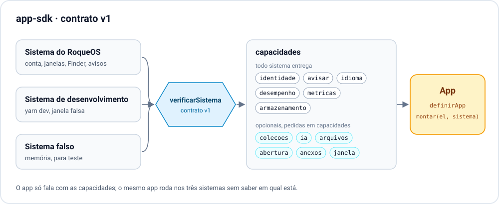

# app-sdk

_English | [Português](README.pt-BR.md)_

The contract between [RoqueOS](https://roqueos.com.br), a desktop operating system that runs in the browser, and an app. An app exports `mount(el, sistema)`; the `sistema` (the system) hands it capabilities (who is using it, in which language, where to keep what belongs to the app, how to show a notice) and the app talks to RoqueOS only through them. The same app runs inside RoqueOS, on its own in the browser and in tests, without knowing which of the three it is in.



## Why it exists

The RoqueOS apps (Calculator, Notes, QR Code, Music and others, 32 in all) were born inside the system's repository, which is closed, and imported its stores directly. From 27/09/2026 they started moving out, each to its own repository in the [roqueos-apps](https://github.com/roqueos-apps) organization, open under MIT. This SDK is what makes that possible: the app depends on it, not on RoqueOS. It is the sibling of [`jogo-sdk`](https://github.com/roqueos-games/jogo-sdk), which did the same for games: same shape, same rules, app capabilities instead of game capabilities.

## Getting started in one minute

You need Node 22 or newer (the `.nvmrc` says 24) and Yarn 1 (`packageManager` in [`package.json`](package.json)).

```bash
git clone https://github.com/roqueos-apps/app-sdk.git && cd app-sdk
yarn install --ignore-scripts
yarn verificar                              # lint, format, tests and app check: the same as CI and pre-push
node bin/app.mjs check test/fixtures/app-ok # the app check on the example app: "ok, o repo cumpre o contrato."
```

In an app repository the SDK is a git dependency pinned by tag, with no package registry, and `yarn dev` mounts the app in the fake window:

```js
import { montarNaJanelaFalsa } from '@roqueos-apps/app-sdk/sistema-de-desenvolvimento'
import manifesto from '../app.json'
import app from '../src/index.js'

montarNaJanelaFalsa(app, { manifesto })
```

The whole path, step by step, is in [docs/GETTING-STARTED.md](docs/GETTING-STARTED.md).

## What each part is

| Part                                                                              | What it does                                                                                                                                             |
| --------------------------------------------------------------------------------- | -------------------------------------------------------------------------------------------------------------------------------------------------------- |
| `definirApp` ([`src/index.js`](src/index.js))                                     | defines an app; its `mount` checks the system first and refuses, with the full list of what is missing, a system that breaks the contract                |
| the contract ([`src/contrato.js`](src/contrato.js))                               | contract v1: six mandatory capabilities and six optional ones, each with its shape and the reason it exists                                              |
| the manifest ([`src/manifesto.js`](src/manifesto.js))                             | `validarManifesto` for the `app.json` every app carries: permanent id, layer, names in the languages, window, capabilities                               |
| `app check` ([`bin/app.mjs`](bin/app.mjs))                                        | checks a whole app repository: install scripts, manifest, translations, asset origin, no database, no RoqueOS imports, CSS variables, declared optionals |
| development system ([`src/host/desenvolvimento.js`](src/host/desenvolvimento.js)) | the app on its own in the plain browser, inside a fake RoqueOS window with a picker for the ten languages                                                |
| fake system ([`src/host/falso.js`](src/host/falso.js))                            | the whole contract in memory, for the app's tests, with a record of what the app did                                                                     |
| `tag-na-main` ([`bin/tag-na-main.mjs`](bin/tag-na-main.mjs))                      | the release tag only on a commit already in `main`; the `tag` workflow runs it                                                                           |

## State and limits

Version 0.3.0 (28/09/2026), contract 1 ([CHANGELOG.md](CHANGELOG.md)). A first-party app runs on the same origin as RoqueOS, so the capability boundary organizes code but is not a security boundary; the community layer, where the contract becomes the boundary, does not exist yet ([SECURITY.md](SECURITY.md)). The `app check` reads the source as text, so it does not see a folder name built at runtime. The full list is in [docs/ARCHITECTURE.md, section 9](docs/ARCHITECTURE.md#9-known-limits).

## Documentation

Everything starts at [docs/INDEX.md](docs/INDEX.md). Each document has a pair in Brazilian Portuguese under [`docs/pt-BR/`](docs/pt-BR/INDEX.md).

| Document                                      | Answers                                                                               |
| --------------------------------------------- | ------------------------------------------------------------------------------------- |
| [GETTING-STARTED.md](docs/GETTING-STARTED.md) | from zero to the gate green and an app mounted in the fake window                     |
| [ARCHITECTURE.md](docs/ARCHITECTURE.md)       | how it works inside: context, components, flows, data, decisions, limits              |
| [REFERENCE.md](docs/REFERENCE.md)             | every export, capability, error code, `app.json` field, command and file              |
| [OPERATIONS.md](docs/OPERATIONS.md)           | the routine, cutting a release, changing the contract without breaking, undoing a tag |
| [WHEN-IT-BREAKS.md](docs/WHEN-IT-BREAKS.md)   | symptom, cause and fix, with the literal message                                      |
| [GLOSSARY.md](docs/GLOSSARY.md)               | the words that mean something specific here                                           |
| [EXTENDING.md](docs/EXTENDING.md)             | adding a capability, an `app check` rule, a CSS variable, a folder, an error code     |
| [INTEGRATIONS.md](docs/INTEGRATIONS.md)       | how RoqueOS, app repositories and the interface kit use the SDK                       |
| [THREAT-MODEL.md](docs/THREAT-MODEL.md)       | what the SDK protects, from whom, and what it does not protect                        |
| [TESTING.md](docs/TESTING.md)                 | what each test suite proves and the acceptance criterion                              |
| [CONTRIBUTING.md](CONTRIBUTING.md)            | how to contribute, and the DCO sign-off on every commit                               |

## Contributing

Read [CONTRIBUTING.md](CONTRIBUTING.md). Every commit carries `Signed-off-by` (DCO), and CI checks it. Code, comments and commits are in Brazilian Portuguese, the canonical language of the project; English issues and pull requests are welcome. Security issues go through [SECURITY.md](SECURITY.md), never a public issue.

## Licence

[MIT](LICENSE). The RoqueOS name and brand belong to LEVELHARD and are not covered by the licence.
