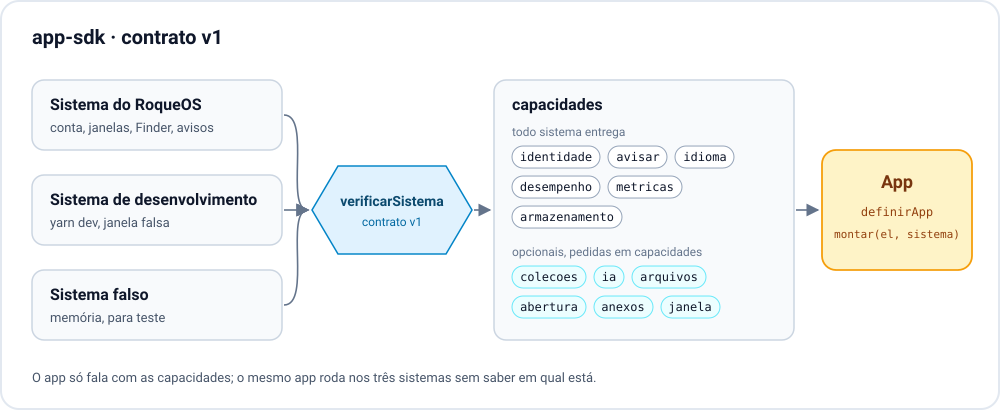

# app-sdk

_[English](README.md) | Português_

O contrato entre o [RoqueOS](https://roqueos.com.br), um sistema operacional de mesa que roda no navegador, e um app. Um app exporta `mount(el, sistema)`; o `sistema` entrega capacidades (quem está usando, em que idioma, onde guardar o que é do app, como avisar alguma coisa na tela) e é só por elas que o app fala com o RoqueOS. O mesmo app roda dentro do RoqueOS, sozinho no navegador e no teste, sem saber em qual dos três está.



## Por que existe

Os apps do RoqueOS (Calculadora, Notas, QR Code, Música e outros, 32 ao todo) nasceram dentro do repositório do sistema, que é fechado, e importavam as stores dele direto. A partir de 27/09/2026 eles começam a sair, cada um para um repo próprio na organização [roqueos-apps](https://github.com/roqueos-apps), abertos sob MIT. Este SDK é o que torna isso possível: o app depende dele, e não do RoqueOS. É o irmão do [`jogo-sdk`](https://github.com/roqueos-games/jogo-sdk), que fez o mesmo com os jogos: mesma forma, mesmas regras, capacidades de app em vez de capacidades de jogo.

## Como começar em um minuto

Você precisa do Node 22 ou mais novo (o `.nvmrc` diz 24) e do Yarn 1 (`packageManager` no [`package.json`](package.json)).

```bash
git clone https://github.com/roqueos-apps/app-sdk.git && cd app-sdk
yarn install --ignore-scripts
yarn verificar                              # lint, formato, testes e app check: o mesmo do CI e do pre-push
node bin/app.mjs check test/fixtures/app-ok # o app check no app de exemplo: "ok, o repo cumpre o contrato."
```

Num repo de app, o SDK entra como dependência git pinada por tag, sem registro de pacote, e o `yarn dev` monta o app na janela falsa:

```js
import { montarNaJanelaFalsa } from '@roqueos-apps/app-sdk/sistema-de-desenvolvimento'
import manifesto from '../app.json'
import app from '../src/index.js'

montarNaJanelaFalsa(app, { manifesto })
```

O caminho inteiro, passo a passo, está em [docs/pt-BR/COMECAR.md](docs/pt-BR/COMECAR.md).

## O que é cada parte

| Parte                                                                                     | O que faz                                                                                                                                                             |
| ----------------------------------------------------------------------------------------- | --------------------------------------------------------------------------------------------------------------------------------------------------------------------- |
| `definirApp` ([`src/index.js`](src/index.js))                                             | define um app; o `mount` dele confere o sistema antes e recusa, com a lista inteira do que falta, o sistema que não cumpre o contrato                                 |
| o contrato ([`src/contrato.js`](src/contrato.js))                                         | contrato v1: seis capacidades obrigatórias e seis opcionais, cada uma com a forma e o motivo de existir                                                               |
| o manifesto ([`src/manifesto.js`](src/manifesto.js))                                      | `validarManifesto` para o `app.json` que todo app leva: id permanente, camada, nomes nos idiomas, janela, capacidades                                                 |
| `app check` ([`bin/app.mjs`](bin/app.mjs))                                                | confere um repo de app inteiro: scripts de instalação, manifesto, traduções, origem dos assets, sem banco, sem import do RoqueOS, variáveis CSS, opcionais declaradas |
| sistema de desenvolvimento ([`src/host/desenvolvimento.js`](src/host/desenvolvimento.js)) | o app sozinho no navegador puro, numa janela falsa do RoqueOS com um seletor dos dez idiomas                                                                          |
| sistema falso ([`src/host/falso.js`](src/host/falso.js))                                  | o contrato inteiro em memória, para o teste do app, com o registro do que o app fez                                                                                   |
| `tag-na-main` ([`bin/tag-na-main.mjs`](bin/tag-na-main.mjs))                              | a tag de release só em commit que já está na `main`; o workflow `tag` roda                                                                                            |

## Estado e limites

Versão 0.3.0 (28/09/2026), contrato 1 ([CHANGELOG.md](CHANGELOG.md)). Um app de primeira parte roda na mesma origem do RoqueOS, então a fronteira das capacidades organiza o código, mas não é fronteira de segurança; a camada de comunidade, onde o contrato vira a fronteira, ainda não existe ([SECURITY.md](SECURITY.md)). O `app check` lê o código como texto, então não vê nome de pasta montado em tempo de execução. A lista inteira está em [docs/pt-BR/ARQUITETURA.md, seção 9](docs/pt-BR/ARQUITETURA.md#9-limites-conhecidos).

## Documentação

Tudo começa em [docs/pt-BR/INDEX.md](docs/pt-BR/INDEX.md). A versão principal é a em inglês, em [`docs/`](docs/INDEX.md); cada documento daqui é o par dela.

| Documento                                               | Responde                                                                                             |
| ------------------------------------------------------- | ---------------------------------------------------------------------------------------------------- |
| [COMECAR.md](docs/pt-BR/COMECAR.md)                     | do zero ao gate verde e a um app montado na janela falsa                                             |
| [ARQUITETURA.md](docs/pt-BR/ARQUITETURA.md)             | como é por dentro: contexto, componentes, fluxos, dados, decisões, limites                           |
| [REFERENCIA.md](docs/pt-BR/REFERENCIA.md)               | todo export, capacidade, código de erro, campo do `app.json`, comando e arquivo                      |
| [OPERACAO.md](docs/pt-BR/OPERACAO.md)                   | a rotina, cortar uma release, mudar o contrato sem quebrar, desfazer uma tag                         |
| [QUANDO-QUEBRA.md](docs/pt-BR/QUANDO-QUEBRA.md)         | sintoma, causa e o que fazer, com a mensagem literal                                                 |
| [GLOSSARIO.md](docs/pt-BR/GLOSSARIO.md)                 | as palavras que querem dizer uma coisa específica aqui                                               |
| [ESTENDER.md](docs/pt-BR/ESTENDER.md)                   | acrescentar uma capacidade, uma regra do `app check`, uma variável CSS, uma pasta, um código de erro |
| [INTEGRACOES.md](docs/pt-BR/INTEGRACOES.md)             | como o RoqueOS, os repos de app e o kit de interface usam o SDK                                      |
| [MODELO-DE-AMEACAS.md](docs/pt-BR/MODELO-DE-AMEACAS.md) | o que o SDK protege, de quem, e o que ele não protege                                                |
| [TESTES.md](docs/pt-BR/TESTES.md)                       | o que cada suíte de teste prova e o critério de aceite                                               |
| [CONTRIBUTING.md](docs/pt-BR/CONTRIBUTING.md)           | como contribuir, e o `Signed-off-by` do DCO em todo commit                                           |

## Contribuir

Leia o [CONTRIBUTING.md](docs/pt-BR/CONTRIBUTING.md). Todo commit leva `Signed-off-by` (DCO), e o CI confere. O código, os comentários e os commits são em português do Brasil, o idioma canônico do projeto; issue e PR em inglês são bem-vindos. Falha de segurança vai pelo [SECURITY.md](SECURITY.md), nunca por issue pública.

## Licença

[MIT](LICENSE). O nome e a marca RoqueOS são da LEVELHARD e não fazem parte da licença.
