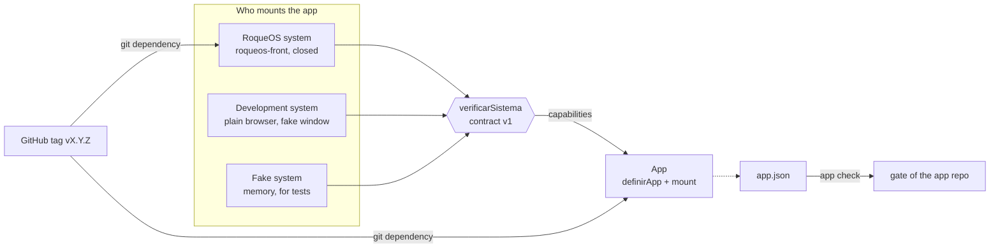
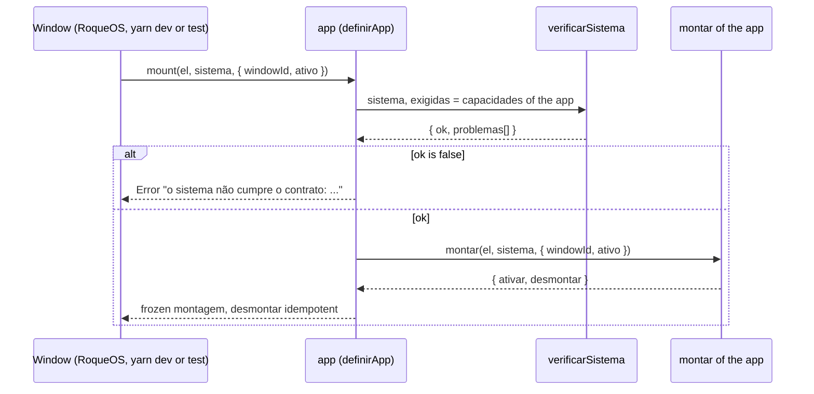
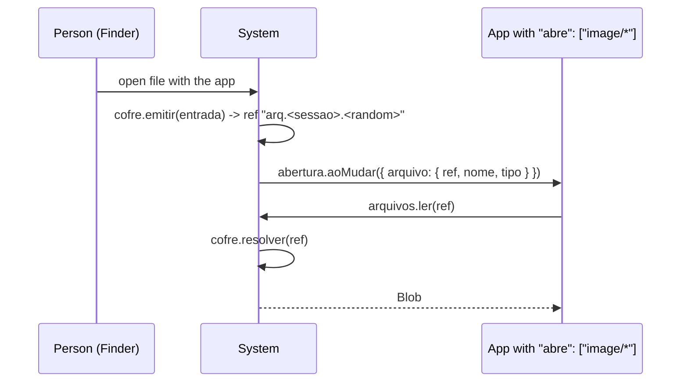
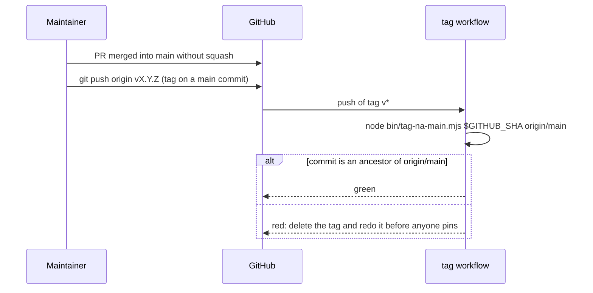

# Architecture

_English | [Português](pt-BR/ARQUITETURA.md)_

> **Who it is for:** whoever is about to change the SDK, implement a system (a host) or move an app out of RoqueOS and needs to know how the pieces fit before touching them.
> **What is here:** the idea, the context, where the code runs, every component with its file, the main flows in sequence diagrams, the data that crosses a boundary, the design decisions with their dates, and the known limits.
> **Where to go for the rest:** every export, field and command is in [REFERENCE.md](REFERENCE.md); how RoqueOS and the app repositories consume the SDK, in [INTEGRATIONS.md](INTEGRATIONS.md); what can go wrong, in [WHEN-IT-BREAKS.md](WHEN-IT-BREAKS.md).

## Contents

1. [The idea in one paragraph](#1-the-idea-in-one-paragraph)
2. [Context: who uses it and what it depends on](#2-context-who-uses-it-and-what-it-depends-on)
3. [Processes and where they run](#3-processes-and-where-they-run)
4. [Components](#4-components)
5. [The main flows](#5-the-main-flows)
6. [Data and contracts](#6-data-and-contracts)
7. [Security and secrets](#7-security-and-secrets)
8. [Design decisions](#8-design-decisions)
9. [Known limits](#9-known-limits)
10. [How the diagrams are made](#10-how-the-diagrams-are-made)

## 1. The idea in one paragraph

An app is an object with `mount(el, sistema)`, built by `definirApp` ([`src/index.js`](../src/index.js)). The `sistema` hands it capabilities and the app talks to RoqueOS only through them: no store, plugin or global style of RoqueOS reaches inside the element. Three systems implement the same contract: the RoqueOS system (which lives in the closed `roqueos-front`, not here), the development system ([`src/host/desenvolvimento.js`](../src/host/desenvolvimento.js)) and the fake system for tests ([`src/host/falso.js`](../src/host/falso.js)). `mount` checks the system against [`src/contrato.js`](../src/contrato.js) before the app runs and refuses, with the whole list of problems, a system that does not comply. Around that core the SDK carries the app manifest `app.json` ([`src/manifesto.js`](../src/manifesto.js)) and the `app check` CLI ([`bin/app.mjs`](../bin/app.mjs), [`src/verificacao.js`](../src/verificacao.js)) that every app repository runs in its gate, so that an app that leaves RoqueOS cannot quietly keep reaching into it.

## 2. Context: who uses it and what it depends on

The apps used to live inside the RoqueOS repository and import its stores directly. From 27/09/2026 they started moving out, each to its own repository in the `roqueos-apps` organization ([README.md](../README.md)). An app depends on this SDK and not on RoqueOS, which is closed.



| Who or what                           | Role                                                                                                                                                                                 | When it is not there                                                                        |
| ------------------------------------- | ------------------------------------------------------------------------------------------------------------------------------------------------------------------------------------ | ------------------------------------------------------------------------------------------- |
| App repositories in `roqueos-apps`    | depend on the SDK by tag, call `definirApp`, run `app check` and test against the fake system                                                                                        | nothing to serve; the SDK has no runtime of its own                                         |
| `roqueos-front` (closed)              | implements the RoqueOS system on top of its stores, validates manifests at build time and runs the same `verificarRepo` on apps still inside it ([INTEGRATIONS.md](INTEGRATIONS.md)) | apps run only in `yarn dev` and in tests                                                    |
| `@roqueos-apps/ui`, the interface kit | uses the CSS variables listed in [`src/variaveis.js`](../src/variaveis.js) to follow the theme                                                                                       | apps draw their own primitives                                                              |
| GitHub                                | hosts the repository and the tags the family pins                                                                                                                                    | `yarn install` of a git dependency fails in every consumer; nothing in the SDK itself stops |
| Runtime dependencies                  | none: [`package.json`](../package.json) has only `devDependencies` (ESLint, Prettier, `globals`)                                                                                     | not applicable                                                                              |

## 3. Processes and where they run

The SDK has no server, daemon or job of its own. Its code runs inside whoever imports it:

| Where                           | What runs                                                                                                   | Started by                                             |
| ------------------------------- | ----------------------------------------------------------------------------------------------------------- | ------------------------------------------------------ |
| The RoqueOS page in the browser | `definirApp`, `verificarSistema`, the shared pieces (`criarAbertura`, `criarTelaCheia`, `criarCofreDeRefs`) | the RoqueOS window that opens the app                  |
| The app's `yarn dev` page       | `montarNaJanelaFalsa` and the development system                                                            | the app repository's dev server                        |
| `node --test` in an app or here | the fake system and the in-memory hosts                                                                     | `yarn test`                                            |
| Node, in a gate or in CI        | `app check` (`bin/app.mjs`)                                                                                 | `yarn app:check` here, the app repository's gate there |
| GitHub Actions                  | `verificar`, `dco` and `tag` ([`.github/workflows/`](../.github/workflows/ci.yml))                          | push to `main`, pull request, push of a `v*` tag       |

## 4. Components

| File                                                                                                                                                                                                | Responsibility                                                                            | Who depends on it                                    |
| --------------------------------------------------------------------------------------------------------------------------------------------------------------------------------------------------- | ----------------------------------------------------------------------------------------- | ---------------------------------------------------- |
| [`src/index.js`](../src/index.js)                                                                                                                                                                   | `definirApp`, `mount`, and everything the package exports from `.`                        | every app, the RoqueOS system                        |
| [`src/contrato.js`](../src/contrato.js)                                                                                                                                                             | `CAPACIDADES` with shape and reason, `OBRIGATORIAS`, `OPCIONAIS`, `verificarSistema`      | `mount`, the manifest, the `app check`, every system |
| [`src/manifesto.js`](../src/manifesto.js)                                                                                                                                                           | `validarManifesto`, `CATEGORIAS`, `CAMADAS`                                               | `app check`, `roqueos-front` build script            |
| [`src/verificacao.js`](../src/verificacao.js)                                                                                                                                                       | every section of the `app check` and `verificarRepo`                                      | `bin/app.mjs`, the `roqueos-front` architecture test |
| [`src/variaveis.js`](../src/variaveis.js)                                                                                                                                                           | `VARIAVEIS_DO_SISTEMA`, the CSS variables an app may read                                 | `app check`, the theme test in `roqueos-front`       |
| [`src/idiomas.js`](../src/idiomas.js)                                                                                                                                                               | the ten languages and `normalizarIdioma`                                                  | manifest, `app check`, both local systems            |
| [`src/erros.js`](../src/erros.js)                                                                                                                                                                   | `ErroDoSistema` and `CODIGOS_DE_ERRO`                                                     | every optional capability                            |
| [`src/colecoes.js`](../src/colecoes.js)                                                                                                                                                             | the semantics of `colecoes`: stamps, plain values, document id                            | in-memory collections, the RoqueOS system            |
| [`src/ia.js`](../src/ia.js)                                                                                                                                                                         | `conferirPedidoDeIa` for `abrirPainel`, app actions                                       | the three systems                                    |
| [`src/arquivos.js`](../src/arquivos.js)                                                                                                                                                             | folders, the `salvar` request, type filter, ordering and the ref vault `criarCofreDeRefs` | the three systems, the manifest                      |
| [`src/abertura.js`](../src/abertura.js)                                                                                                                                                             | `criarAbertura`, used by the three systems                                                | the three systems                                    |
| [`src/janela.js`](../src/janela.js)                                                                                                                                                                 | `criarTelaCheia`, used by the three systems                                               | the three systems                                    |
| [`src/anexos.js`](../src/anexos.js)                                                                                                                                                                 | attachment id, size ceiling and the content check                                         | the three systems                                    |
| [`src/e2e.js`](../src/e2e.js)                                                                                                                                                                       | `emModoE2E` and `estadoE2E`, read from `window.__ROS_E2E__`                               | apps under Playwright or Cypress                     |
| [`src/host/armazenamento.js`](../src/host/armazenamento.js)                                                                                                                                         | the `roqueos:<app>:<chave>` key space over any Storage                                    | both local systems                                   |
| [`src/host/colecoes-em-memoria.js`](../src/host/colecoes-em-memoria.js), [`arquivos-em-memoria.js`](../src/host/arquivos-em-memoria.js), [`anexos-em-memoria.js`](../src/host/anexos-em-memoria.js) | the optional capabilities in memory, with the RoqueOS semantics                           | both local systems                                   |
| [`src/host/desenvolvimento.js`](../src/host/desenvolvimento.js)                                                                                                                                     | `criarSistemaDeDesenvolvimento` and `montarNaJanelaFalsa`                                 | the `yarn dev` of every app                          |
| [`src/host/falso.js`](../src/host/falso.js)                                                                                                                                                         | `criarSistemaFalso`, the record and the levers that move the world around the app         | every app's tests                                    |
| [`bin/app.mjs`](../bin/app.mjs)                                                                                                                                                                     | the `app check` CLI                                                                       | gates and CI                                         |
| [`bin/tag-na-main.mjs`](../bin/tag-na-main.mjs)                                                                                                                                                     | the release tag only on a commit in `main`                                                | the `tag` workflow                                   |

## 5. The main flows

### 5.1 Mounting an app



`mount` checks the element, then the system: contract version, the six mandatory capabilities and the optional ones the app declared ([`src/index.js`](../src/index.js)). The list of problems is complete, not the first one, because an incomplete system is fixed in one go ([`src/contrato.js`](../src/contrato.js)). The returned montagem ignores a second `desmontar`, because a window closing and the surrounding component unmounting both call it.

### 5.2 The app check in an app repository

```mermaid
sequenceDiagram
  participant G as gate of the app (yarn verificar, CI)
  participant B as bin/app.mjs check
  participant V as verificarRepo
  G->>B: app check [folder] [--json]
  B->>V: folder, { sdk }
  V->>V: install scripts, manifest, texts, assets
  V->>V: database, RoqueOS imports, CSS variables
  V->>V: declared optionals, declared folders
  V-->>B: [{ secao, problemas[] }]
  B-->>G: "REPROVOU" per section, exit 1; or "ok, o repo cumpre o contrato.", exit 0
```

There is no warning level: a problem that does not fail is a problem nobody fixes ([`bin/app.mjs`](../bin/app.mjs)). In the SDK itself, `yarn app:check` runs with `--sdk`, which keeps only the install-scripts section.

### 5.3 "Open with" from the Finder



The file is read even if the app did not declare its folder in `pastas`: the person granted it by choosing the app ([`src/arquivos.js`](../src/arquivos.js), [`src/abertura.js`](../src/abertura.js)). In `yarn dev` the "Abrir arquivo" input in the fake window bar plays the Finder's part; in tests, `abrirCom` of the fake system does.

### 5.4 Cutting a release



The steps are in [OPERATIONS.md](OPERATIONS.md#2-cutting-a-release).

## 6. Data and contracts

The contract is the `CAPACIDADES` object in [`src/contrato.js`](../src/contrato.js): for each capability, whether it is mandatory, its shape (`fn` or an object of functions) and the reason it exists. A system is an object with `versaoDoContrato: 1` and those keys. The full table is in [REFERENCE.md](REFERENCE.md#2-capabilities).

The manifest is the `app.json` at the root of each app repository. The minimal valid one, taken from the test fixture ([`test/fixtures/app-ok/app.json`](../test/fixtures/app-ok/app.json)), shortened to two languages here (first party needs all ten):

```json
{
  "id": "contador",
  "versaoDoContrato": 1,
  "camada": "primeira-parte",
  "nome": { "pt-BR": "Contador", "en-US": "Counter" },
  "descricao": {
    "pt-BR": "Um contador para o teste do SDK.",
    "en-US": "A counter for the SDK test."
  },
  "icone": "public/icone.svg",
  "cor": "#ff9500",
  "categoria": "utilities",
  "janela": {
    "largura": 320,
    "altura": 240,
    "minLargura": 240,
    "minAltura": 200,
    "maximizavel": false
  },
  "capacidades": [],
  "autor": "Roque Ribeiro",
  "licenca": "MIT"
}
```

The formats that cross a boundary:

| Data                | Format                                                                                    | Source                                                      |
| ------------------- | ----------------------------------------------------------------------------------------- | ----------------------------------------------------------- |
| storage key         | `roqueos:<app>:<chave>`, the same apps already used in RoqueOS's `localStorage`           | [`src/host/armazenamento.js`](../src/host/armazenamento.js) |
| collection document | `{ id, ...campos, criadoEm, atualizadoEm }`, dates in milliseconds, stamped by the system | [`src/colecoes.js`](../src/colecoes.js)                     |
| file ref            | `arq.<sessao>.<random>`, opaque, valid for this app in this session                       | [`src/arquivos.js`](../src/arquivos.js)                     |
| `listar` entry      | `{ ref, nome, tipo, tamanho, modificadoEm }`, newest first                                | [`src/arquivos.js`](../src/arquivos.js)                     |
| attachment id       | `anx_` and 24 symbols from `a-z2-7` (120 bits)                                            | [`src/anexos.js`](../src/anexos.js)                         |
| "open with" request | `{ arquivo: { ref, nome, tipo } }` in `abertura`                                          | [`src/abertura.js`](../src/abertura.js)                     |
| `app check --json`  | `{ ok, pasta, secoes: [{ secao, problemas }] }`                                           | [`bin/app.mjs`](../bin/app.mjs)                             |

## 7. Security and secrets

The SDK holds no secret: no token, key or `.env`, and the `verificar` and `dco` workflows run on pull requests with read-only permission and no secret ([`.github/workflows/ci.yml`](../.github/workflows/ci.yml)). The AI agents' keys never reach an app: `ia` only lets the app say where the system's panel appears, what it reads and where the result goes ([`src/ia.js`](../src/ia.js)). What the capabilities protect, and the fact that on the same origin they are not a security boundary, is in [THREAT-MODEL.md](THREAT-MODEL.md).

## 8. Design decisions

| Decided                                                                                              | Rejected alternative               | Why                                                                                                                                                          | When and source                                                    |
| ---------------------------------------------------------------------------------------------------- | ---------------------------------- | ------------------------------------------------------------------------------------------------------------------------------------------------------------ | ------------------------------------------------------------------ |
| The app receives capabilities, not stores                                                            | hand the app RoqueOS's stores      | an app with the whole store can open windows, read server credentials and change the desktop; with `armazenamento.gravar` it can only write in its own space | 0.1.0, 27/09/2026, [`src/contrato.js`](../src/contrato.js)         |
| Six mandatory capabilities, the ones from `jogo-sdk`                                                 | a bigger mandatory set             | `jogo-sdk` already proves them in twenty games, with the same shape and reason                                                                               | 0.1.0, 27/09/2026, [`src/contrato.js`](../src/contrato.js)         |
| A new capability is born optional, with a written reason, in the wave of the first app that needs it | capabilities designed ahead of use | a capability without a reason becomes a shortcut for the app to reach what it should not                                                                     | 0.2.0, 27/09/2026, [CLAUDE.md](../CLAUDE.md)                       |
| Adding a function to an optional is a minor version; removing or changing one is a new contract      | treat every change as breaking     | the old app is still served by the new system; a system refuses an app asking for another contract instead of breaking at runtime                            | 0.3.0, 28/09/2026, [CHANGELOG.md](../CHANGELOG.md)                 |
| Distribution by git tag, no package registry                                                         | publish to a registry              | the family pins the SDK by tag, and RoqueOS locks the exact SHA in its lockfile                                                                              | 0.1.0, [README.md](../README.md), [SECURITY.md](../SECURITY.md)    |
| The release tag only on a commit already in `main`                                                   | tag on the PR branch               | v0.2.0 was tagged on a PR #4 commit; a squash merge would have left the family pinned to a commit `main` never contains                                      | 0.3.0, 28/09/2026, [`bin/tag-na-main.mjs`](../bin/tag-na-main.mjs) |
| No install scripts, no runtime dependency                                                            | allow `prepare` and friends        | RoqueOS installs the app as a dependency, and the script would run on the machine of whoever builds; `yarn` runs `prepare` on git dependencies               | 0.1.0, [`src/verificacao.js`](../src/verificacao.js)               |
| An unknown `app.json` field fails                                                                    | ignore unknown fields              | a `maximizável` with an accent would be ignored in silence and the window would open differently from what the author wrote                                  | 0.1.0, [`src/manifesto.js`](../src/manifesto.js)                   |
| The `app check` has no warnings                                                                      | a warning level                    | a problem that does not fail is a problem nobody fixes                                                                                                       | 0.1.0, [`bin/app.mjs`](../bin/app.mjs)                             |
| CSS variables of the theme are contract, both sides locked                                           | let apps read any `--ros-*`        | `var()` is a real dependency no build graph sees; renaming one in RoqueOS would drop the colour in silence                                                   | 0.1.0 and 0.2.0, [`src/variaveis.js`](../src/variaveis.js)         |
| One AI panel for every app, owned by the system                                                      | each app draws its own panel       | a panel per app drifts in weeks, and the agent key cannot reach the app; order of the founder, 25/07/2026                                                    | 0.2.0, [`src/ia.js`](../src/ia.js)                                 |
| File refs are opaque and per session                                                                 | paths, or durable ids for files    | the app never sees where the person's files live and keeps no pointer to their folders; to remember a file it remembers the name and lists again             | 0.3.0, 28/09/2026, [`src/arquivos.js`](../src/arquivos.js)         |
| Attachments by durable id, never a URL                                                               | hand the app a Storage URL         | a durable URL is a link anyone holding it can read forever, and in the community layer it would leave over the network                                       | 0.3.0, 28/09/2026, [`src/anexos.js`](../src/anexos.js)             |
| Full screen is done by the system                                                                    | the app calls `requestFullscreen`  | in RoqueOS full screen writes to `<html>`, which an app cannot do because the class leaks to the next apps                                                   | 0.3.0, 28/09/2026, [`src/janela.js`](../src/janela.js)             |

## 9. Known limits

- **On the same origin the contract is not a security boundary.** First-party code can read what the page reads; protection comes from review and exact pins ([SECURITY.md](../SECURITY.md)). The community layer (cross-origin iframe without `allow-same-origin`) does not exist yet.
- **The `app check` reads text.** A folder name built at runtime is not seen by the declared-folders rule, and an optional reached through a variable not called `sistema` is not seen by the declared-optionals rule ([`src/verificacao.js`](../src/verificacao.js)). The system still refuses at runtime.
- **The permanence of `id` is not checked here.** The SDK checks only the format; RoqueOS compares with the published id ([`src/manifesto.js`](../src/manifesto.js)).
- **Forgotten attachments stay.** An attachment the app no longer uses is not collected; accepted risk in the first version ([`src/anexos.js`](../src/anexos.js)).
- **The development system is not RoqueOS.** Identity changes are not emitted (`aoMudar` never fires), attachments and files live in memory and vanish on F5, and the AI panel is only a notice ([`src/host/desenvolvimento.js`](../src/host/desenvolvimento.js)).
- **`docs/contrato.svg` is a static file with no generating script**, against section 6 of the family documentation standard. Redrawing it is manual. Not proven to match the current contract beyond what the picture shows.
- **The documentation gate is not wired into `yarn verificar`.** `roqueos-docs` runs from the kit, not from this repository's `package.json`.

## 10. How the diagrams are made

The diagrams in this document and in [INDEX.md](INDEX.md#diagrams) are Mermaid inside the Markdown: GitHub renders them, the source is the text, and the Portuguese pair translates the labels. The README picture, [`contrato.svg`](contrato.svg), is the exception noted in section 9.
