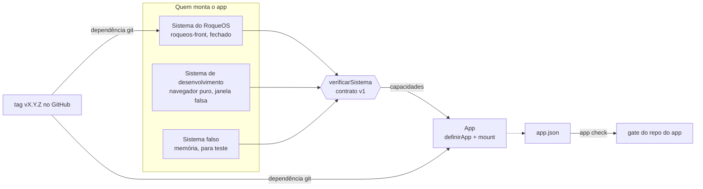
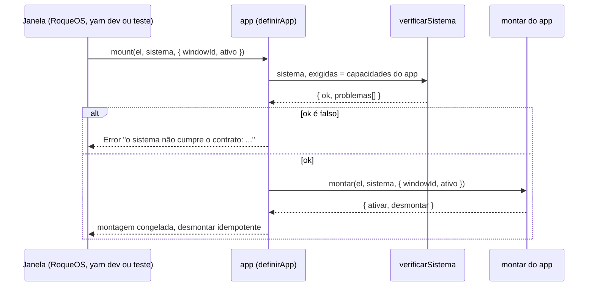
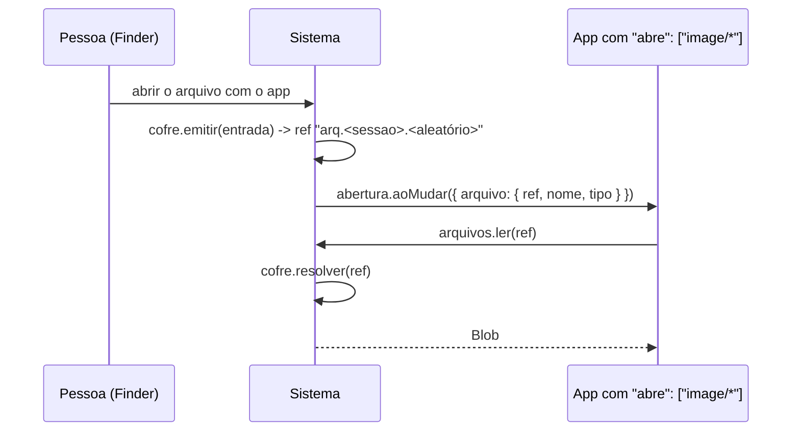
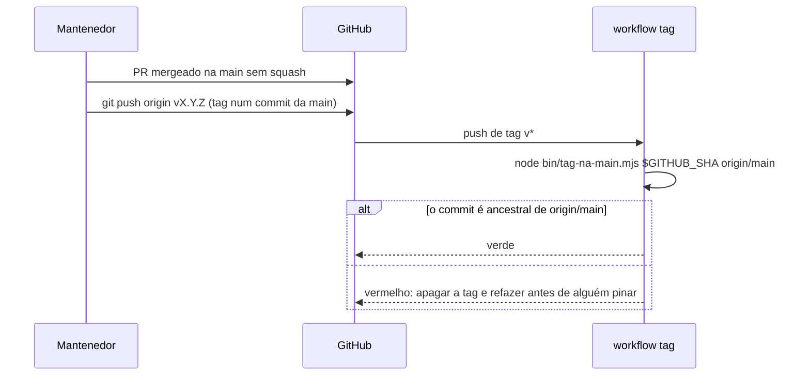

# Arquitetura

_[English](../ARCHITECTURE.md) | Português_

> **Para quem:** quem vai mudar o SDK, implementar um sistema (um host) ou tirar um app do RoqueOS e precisa saber como as peças se encaixam antes de mexer nelas.
> **O que tem aqui:** a ideia, o contexto, onde o código roda, cada componente com o arquivo dele, os fluxos principais em diagrama de sequência, os dados que atravessam uma fronteira, as decisões de design com data e os limites conhecidos.
> **Onde ir para o resto:** todo export, campo e comando está em [REFERENCIA.md](REFERENCIA.md); como o RoqueOS e os repos de app consomem o SDK, em [INTEGRACOES.md](INTEGRACOES.md); o que pode dar errado, em [QUANDO-QUEBRA.md](QUANDO-QUEBRA.md).

## Sumário

1. [A ideia em um parágrafo](#1-a-ideia-em-um-parágrafo)
2. [Contexto: quem usa e do que depende](#2-contexto-quem-usa-e-do-que-depende)
3. [Processos e onde rodam](#3-processos-e-onde-rodam)
4. [Componentes](#4-componentes)
5. [Os fluxos principais](#5-os-fluxos-principais)
6. [Dados e contratos](#6-dados-e-contratos)
7. [Segurança e segredos](#7-segurança-e-segredos)
8. [Decisões de design](#8-decisões-de-design)
9. [Limites conhecidos](#9-limites-conhecidos)
10. [Como os diagramas são feitos](#10-como-os-diagramas-são-feitos)

## 1. A ideia em um parágrafo

Um app é um objeto com `mount(el, sistema)`, criado por `definirApp` ([`src/index.js`](../../src/index.js)). O `sistema` entrega capacidades e é só por elas que o app fala com o RoqueOS: nenhuma store, nenhum plugin e nenhum estilo global do RoqueOS chega dentro do elemento. Três sistemas implementam o mesmo contrato: o sistema do RoqueOS (que mora no `roqueos-front`, fechado, e não aqui), o sistema de desenvolvimento ([`src/host/desenvolvimento.js`](../../src/host/desenvolvimento.js)) e o sistema falso para teste ([`src/host/falso.js`](../../src/host/falso.js)). O `mount` confere o sistema contra [`src/contrato.js`](../../src/contrato.js) antes de o app rodar e recusa, com a lista inteira dos problemas, o sistema que não cumpre. Em volta desse núcleo o SDK leva o manifesto do app, o `app.json` ([`src/manifesto.js`](../../src/manifesto.js)), e o CLI `app check` ([`bin/app.mjs`](../../bin/app.mjs), [`src/verificacao.js`](../../src/verificacao.js)), que todo repo de app roda no gate, para que o app que sai do RoqueOS não continue alcançando o que está dentro dele calado.

## 2. Contexto: quem usa e do que depende

Os apps moravam dentro do repositório do RoqueOS e importavam as stores dele direto. A partir de 27/09/2026 eles começaram a sair, cada um para um repo próprio na organização `roqueos-apps` ([README.pt-BR.md](../../README.pt-BR.md)). Um app depende deste SDK, e não do RoqueOS, que é fechado.



| Quem ou o quê                          | Papel                                                                                                                                                                              | Quando não está                                                                        |
| -------------------------------------- | ---------------------------------------------------------------------------------------------------------------------------------------------------------------------------------- | -------------------------------------------------------------------------------------- |
| Repos de app em `roqueos-apps`         | dependem do SDK por tag, chamam `definirApp`, rodam o `app check` e testam contra o sistema falso                                                                                  | nada a servir; o SDK não tem runtime próprio                                           |
| `roqueos-front` (fechado)              | implementa o sistema do RoqueOS por cima das stores, valida os manifestos no build e roda o mesmo `verificarRepo` nos apps que ainda moram nele ([INTEGRACOES.md](INTEGRACOES.md)) | os apps só rodam no `yarn dev` e no teste                                              |
| `@roqueos-apps/ui`, o kit de interface | usa as variáveis CSS listadas em [`src/variaveis.js`](../../src/variaveis.js) para acompanhar o tema                                                                               | cada app desenha os próprios primitivos                                                |
| GitHub                                 | hospeda o repositório e as tags que a família pina                                                                                                                                 | o `yarn install` de dependência git falha em todo consumidor; nada no próprio SDK para |
| Dependências de runtime                | nenhuma: o [`package.json`](../../package.json) só tem `devDependencies` (ESLint, Prettier, `globals`)                                                                             | não se aplica                                                                          |

## 3. Processos e onde rodam

O SDK não tem servidor, daemon nem job próprio. O código dele roda dentro de quem o importa:

| Onde                             | O que roda                                                                                                | Quem sobe                                       |
| -------------------------------- | --------------------------------------------------------------------------------------------------------- | ----------------------------------------------- |
| A página do RoqueOS no navegador | `definirApp`, `verificarSistema`, as peças comuns (`criarAbertura`, `criarTelaCheia`, `criarCofreDeRefs`) | a janela do RoqueOS que abre o app              |
| A página do `yarn dev` do app    | `montarNaJanelaFalsa` e o sistema de desenvolvimento                                                      | o servidor de desenvolvimento do repo do app    |
| `node --test` num app ou aqui    | o sistema falso e os hosts em memória                                                                     | `yarn test`                                     |
| Node, num gate ou no CI          | o `app check` (`bin/app.mjs`)                                                                             | `yarn app:check` aqui, o gate do repo do app lá |
| GitHub Actions                   | `verificar`, `dco` e `tag` ([`.github/workflows/`](../../.github/workflows/ci.yml))                       | push na `main`, pull request, push de tag `v*`  |

## 4. Componentes

| Arquivo                                                                                                                                                                                                      | Responsabilidade                                                                                 | Quem depende dele                                          |
| ------------------------------------------------------------------------------------------------------------------------------------------------------------------------------------------------------------ | ------------------------------------------------------------------------------------------------ | ---------------------------------------------------------- |
| [`src/index.js`](../../src/index.js)                                                                                                                                                                         | `definirApp`, `mount` e tudo o que o pacote exporta em `.`                                       | todo app, o sistema do RoqueOS                             |
| [`src/contrato.js`](../../src/contrato.js)                                                                                                                                                                   | `CAPACIDADES` com forma e motivo, `OBRIGATORIAS`, `OPCIONAIS`, `verificarSistema`                | o `mount`, o manifesto, o `app check`, todo sistema        |
| [`src/manifesto.js`](../../src/manifesto.js)                                                                                                                                                                 | `validarManifesto`, `CATEGORIAS`, `CAMADAS`                                                      | o `app check`, o script de build do `roqueos-front`        |
| [`src/verificacao.js`](../../src/verificacao.js)                                                                                                                                                             | cada seção do `app check` e o `verificarRepo`                                                    | o `bin/app.mjs`, o teste de arquitetura do `roqueos-front` |
| [`src/variaveis.js`](../../src/variaveis.js)                                                                                                                                                                 | `VARIAVEIS_DO_SISTEMA`, as variáveis CSS que um app pode ler                                     | o `app check`, o teste do tema no `roqueos-front`          |
| [`src/idiomas.js`](../../src/idiomas.js)                                                                                                                                                                     | os dez idiomas e `normalizarIdioma`                                                              | manifesto, `app check`, os dois sistemas locais            |
| [`src/erros.js`](../../src/erros.js)                                                                                                                                                                         | `ErroDoSistema` e `CODIGOS_DE_ERRO`                                                              | toda capacidade opcional                                   |
| [`src/colecoes.js`](../../src/colecoes.js)                                                                                                                                                                   | a semântica de `colecoes`: carimbos, valores simples, id de documento                            | as coleções em memória, o sistema do RoqueOS               |
| [`src/ia.js`](../../src/ia.js)                                                                                                                                                                               | `conferirPedidoDeIa` para o `abrirPainel`, as ações do app                                       | os três sistemas                                           |
| [`src/arquivos.js`](../../src/arquivos.js)                                                                                                                                                                   | as pastas, o pedido de `salvar`, o filtro de tipos, a ordem e o cofre de refs `criarCofreDeRefs` | os três sistemas, o manifesto                              |
| [`src/abertura.js`](../../src/abertura.js)                                                                                                                                                                   | `criarAbertura`, que os três sistemas usam                                                       | os três sistemas                                           |
| [`src/janela.js`](../../src/janela.js)                                                                                                                                                                       | `criarTelaCheia`, que os três sistemas usam                                                      | os três sistemas                                           |
| [`src/anexos.js`](../../src/anexos.js)                                                                                                                                                                       | o id de anexo, o teto de tamanho e a conferência do conteúdo                                     | os três sistemas                                           |
| [`src/e2e.js`](../../src/e2e.js)                                                                                                                                                                             | `emModoE2E` e `estadoE2E`, lidos de `window.__ROS_E2E__`                                         | apps sob Playwright ou Cypress                             |
| [`src/host/armazenamento.js`](../../src/host/armazenamento.js)                                                                                                                                               | o espaço de chaves `roqueos:<app>:<chave>` sobre qualquer Storage                                | os dois sistemas locais                                    |
| [`src/host/colecoes-em-memoria.js`](../../src/host/colecoes-em-memoria.js), [`arquivos-em-memoria.js`](../../src/host/arquivos-em-memoria.js), [`anexos-em-memoria.js`](../../src/host/anexos-em-memoria.js) | as capacidades opcionais em memória, com a semântica do RoqueOS                                  | os dois sistemas locais                                    |
| [`src/host/desenvolvimento.js`](../../src/host/desenvolvimento.js)                                                                                                                                           | `criarSistemaDeDesenvolvimento` e `montarNaJanelaFalsa`                                          | o `yarn dev` de todo app                                   |
| [`src/host/falso.js`](../../src/host/falso.js)                                                                                                                                                               | `criarSistemaFalso`, o registro e as alavancas que mexem no mundo em volta do app                | o teste de todo app                                        |
| [`bin/app.mjs`](../../bin/app.mjs)                                                                                                                                                                           | o CLI do `app check`                                                                             | gates e CI                                                 |
| [`bin/tag-na-main.mjs`](../../bin/tag-na-main.mjs)                                                                                                                                                           | a tag de release só em commit da `main`                                                          | o workflow `tag`                                           |

## 5. Os fluxos principais

### 5.1 Montar um app



O `mount` confere o elemento e depois o sistema: a versão do contrato, as seis obrigatórias e as opcionais que o app declarou ([`src/index.js`](../../src/index.js)). A lista de problemas vem inteira, e não o primeiro, porque sistema incompleto se conserta de uma vez ([`src/contrato.js`](../../src/contrato.js)). A montagem devolvida ignora o segundo `desmontar`, porque a janela que fecha e o componente em volta que desmonta chamam os dois.

### 5.2 O app check num repo de app

```mermaid
sequenceDiagram
  participant G as gate do app (yarn verificar, CI)
  participant B as bin/app.mjs check
  participant V as verificarRepo
  G->>B: app check [pasta] [--json]
  B->>V: pasta, { sdk }
  V->>V: scripts de instalação, manifesto, textos, assets
  V->>V: banco, imports do RoqueOS, variáveis CSS
  V->>V: opcionais declaradas, pastas declaradas
  V-->>B: [{ secao, problemas[] }]
  B-->>G: "REPROVOU" por seção, saída 1; ou "ok, o repo cumpre o contrato.", saída 0
```

Não há nível de aviso: problema que não reprova é problema que ninguém conserta ([`bin/app.mjs`](../../bin/app.mjs)). No próprio SDK, o `yarn app:check` roda com `--sdk`, que deixa só a seção dos scripts de instalação.

### 5.3 O "abrir com" do Finder



O arquivo é lido mesmo que o app não tenha declarado a pasta dele em `pastas`: quem concedeu foi a pessoa, ao escolher o app ([`src/arquivos.js`](../../src/arquivos.js), [`src/abertura.js`](../../src/abertura.js)). No `yarn dev`, o campo "Abrir arquivo" na barra da janela falsa faz o papel do Finder; no teste, o `abrirCom` do sistema falso.

### 5.4 Cortar uma release



Os passos estão em [OPERACAO.md](OPERACAO.md#2-cortar-uma-release).

## 6. Dados e contratos

O contrato é o objeto `CAPACIDADES` em [`src/contrato.js`](../../src/contrato.js): para cada capacidade, se é obrigatória, a forma (`fn` ou um objeto de funções) e o motivo de existir. Um sistema é um objeto com `versaoDoContrato: 1` e essas chaves. A tabela inteira está em [REFERENCIA.md](REFERENCIA.md#2-capacidades).

O manifesto é o `app.json` na raiz de cada repo de app. O menor válido, tirado do fixture de teste ([`test/fixtures/app-ok/app.json`](../../test/fixtures/app-ok/app.json)), encurtado aqui para dois idiomas (primeira parte precisa dos dez):

```json
{
  "id": "contador",
  "versaoDoContrato": 1,
  "camada": "primeira-parte",
  "nome": { "pt-BR": "Contador", "en-US": "Counter" },
  "descricao": {
    "pt-BR": "Um contador para o teste do SDK.",
    "en-US": "A counter for the SDK test."
  },
  "icone": "public/icone.svg",
  "cor": "#ff9500",
  "categoria": "utilities",
  "janela": {
    "largura": 320,
    "altura": 240,
    "minLargura": 240,
    "minAltura": 200,
    "maximizavel": false
  },
  "capacidades": [],
  "autor": "Roque Ribeiro",
  "licenca": "MIT"
}
```

Os formatos que atravessam uma fronteira:

| Dado                   | Formato                                                                                      | Fonte                                                          |
| ---------------------- | -------------------------------------------------------------------------------------------- | -------------------------------------------------------------- |
| chave de armazenamento | `roqueos:<app>:<chave>`, a mesma que os apps já usavam no `localStorage` do RoqueOS          | [`src/host/armazenamento.js`](../../src/host/armazenamento.js) |
| documento de coleção   | `{ id, ...campos, criadoEm, atualizadoEm }`, datas em milissegundos, carimbadas pelo sistema | [`src/colecoes.js`](../../src/colecoes.js)                     |
| ref de arquivo         | `arq.<sessao>.<aleatório>`, opaca, vale para este app nesta sessão                           | [`src/arquivos.js`](../../src/arquivos.js)                     |
| entrada de `listar`    | `{ ref, nome, tipo, tamanho, modificadoEm }`, os mais novos primeiro                         | [`src/arquivos.js`](../../src/arquivos.js)                     |
| id de anexo            | `anx_` e 24 símbolos de `a-z2-7` (120 bits)                                                  | [`src/anexos.js`](../../src/anexos.js)                         |
| pedido do "abrir com"  | `{ arquivo: { ref, nome, tipo } }` na `abertura`                                             | [`src/abertura.js`](../../src/abertura.js)                     |
| `app check --json`     | `{ ok, pasta, secoes: [{ secao, problemas }] }`                                              | [`bin/app.mjs`](../../bin/app.mjs)                             |

## 7. Segurança e segredos

O SDK não guarda segredo nenhum: nem token, nem chave, nem `.env`, e os workflows `verificar` e `dco` rodam em pull request com permissão só de leitura e sem segredo ([`.github/workflows/ci.yml`](../../.github/workflows/ci.yml)). A chave dos agentes de IA nunca chega a um app: a `ia` só deixa o app dizer onde o painel do sistema aparece, o que ele lê e onde o resultado entra ([`src/ia.js`](../../src/ia.js)). O que as capacidades protegem, e o fato de na mesma origem elas não serem fronteira de segurança, está em [MODELO-DE-AMEACAS.md](MODELO-DE-AMEACAS.md).

## 8. Decisões de design

| Decidido                                                                                | Alternativa recusada                    | Por quê                                                                                                                                         | Quando e fonte                                                                    |
| --------------------------------------------------------------------------------------- | --------------------------------------- | ----------------------------------------------------------------------------------------------------------------------------------------------- | --------------------------------------------------------------------------------- |
| O app recebe capacidades, e não stores                                                  | entregar ao app as stores do RoqueOS    | um app com a store inteira abre janela, lê credencial de servidor e mexe no desktop; com `armazenamento.gravar` ele só grava no espaço dele     | 0.1.0, 27/09/2026, [`src/contrato.js`](../../src/contrato.js)                     |
| Seis capacidades obrigatórias, as do `jogo-sdk`                                         | um conjunto obrigatório maior           | o `jogo-sdk` já as prova em vinte jogos, com a mesma forma e o mesmo motivo                                                                     | 0.1.0, 27/09/2026, [`src/contrato.js`](../../src/contrato.js)                     |
| Capacidade nova nasce opcional, com motivo escrito, na onda do primeiro app que precisa | desenhar capacidades antes do uso       | capacidade sem motivo vira atalho para o app alcançar o que não devia                                                                           | 0.2.0, 27/09/2026, [CLAUDE.md](../../CLAUDE.md)                                   |
| Acrescentar função a uma opcional é versão menor; tirar ou mudar uma é contrato novo    | tratar toda mudança como quebra         | o app de antes continua servido pelo sistema novo; o sistema recusa o app que pede outro contrato em vez de quebrar em runtime                  | 0.3.0, 28/09/2026, [CHANGELOG.md](../../CHANGELOG.md)                             |
| Distribuição por tag git, sem registro de pacote                                        | publicar num registro                   | a família pina o SDK por tag, e o RoqueOS trava o SHA exato no lockfile                                                                         | 0.1.0, [README.pt-BR.md](../../README.pt-BR.md), [SECURITY.md](../../SECURITY.md) |
| A tag de release só em commit que já está na `main`                                     | tag no branch do PR                     | a v0.2.0 nasceu num commit do PR #4; um merge por squash deixaria a família pinada num commit que a `main` nunca contém                         | 0.3.0, 28/09/2026, [`bin/tag-na-main.mjs`](../../bin/tag-na-main.mjs)             |
| Sem script de instalação, sem dependência de runtime                                    | permitir `prepare` e companhia          | o RoqueOS instala o app como dependência, e o script rodaria na máquina de quem builda; o `yarn` roda o `prepare` em dependência git            | 0.1.0, [`src/verificacao.js`](../../src/verificacao.js)                           |
| Campo desconhecido no `app.json` reprova                                                | ignorar campo desconhecido              | um `maximizável` com acento seria ignorado em silêncio, e a janela abriria diferente do que o autor escreveu                                    | 0.1.0, [`src/manifesto.js`](../../src/manifesto.js)                               |
| O `app check` não tem aviso                                                             | um nível de aviso                       | problema que não reprova é problema que ninguém conserta                                                                                        | 0.1.0, [`bin/app.mjs`](../../bin/app.mjs)                                         |
| As variáveis CSS do tema são contrato, com os dois lados travados                       | deixar o app ler qualquer `--ros-*`     | `var()` é dependência de verdade que nenhum grafo de build vê; renomear uma no RoqueOS tiraria a cor em silêncio                                | 0.1.0 e 0.2.0, [`src/variaveis.js`](../../src/variaveis.js)                       |
| Um painel de IA para todos os apps, do sistema                                          | cada app desenha o próprio painel       | painel por app deriva em semanas, e a chave do agente não pode chegar ao app; ordem do founder, 25/07/2026                                      | 0.2.0, [`src/ia.js`](../../src/ia.js)                                             |
| A ref de arquivo é opaca e por sessão                                                   | caminhos, ou ids duráveis para arquivos | o app nunca vê onde moram os arquivos da pessoa nem guarda ponteiro para as pastas dela; para lembrar um arquivo, lembra o nome e lista de novo | 0.3.0, 28/09/2026, [`src/arquivos.js`](../../src/arquivos.js)                     |
| Anexo por id durável, nunca URL                                                         | entregar ao app uma URL do Storage      | uma URL durável é um link que qualquer um que o tenha lê para sempre, e no modo comunidade ela sairia pela rede                                 | 0.3.0, 28/09/2026, [`src/anexos.js`](../../src/anexos.js)                         |
| A tela cheia é feita pelo sistema                                                       | o app chama `requestFullscreen`         | no RoqueOS a tela cheia escreve no `<html>`, o que um app não pode, porque a classe vaza para os apps seguintes                                 | 0.3.0, 28/09/2026, [`src/janela.js`](../../src/janela.js)                         |

## 9. Limites conhecidos

- **Na mesma origem o contrato não é fronteira de segurança.** Código de primeira parte lê o que a página lê; a proteção vem da revisão e do pin exato ([SECURITY.md](../../SECURITY.md)). A camada de comunidade (iframe em outra origem, sem `allow-same-origin`) ainda não existe.
- **O `app check` lê texto.** Nome de pasta montado em tempo de execução escapa da regra das pastas declaradas, e opcional alcançada por uma variável que não se chama `sistema` escapa da regra das opcionais declaradas ([`src/verificacao.js`](../../src/verificacao.js)). O sistema recusa do mesmo jeito em runtime.
- **A permanência do `id` não se confere aqui.** O SDK confere só o formato; quem compara com o id publicado é o RoqueOS ([`src/manifesto.js`](../../src/manifesto.js)).
- **Anexo esquecido fica.** O anexo que o app não usa mais não é recolhido; risco aceito na primeira versão ([`src/anexos.js`](../../src/anexos.js)).
- **O sistema de desenvolvimento não é o RoqueOS.** A troca de identidade não é emitida (`aoMudar` nunca dispara), anexos e arquivos ficam em memória e somem no F5, e o painel de IA é só um aviso ([`src/host/desenvolvimento.js`](../../src/host/desenvolvimento.js)).
- **O `docs/contrato.svg` é um arquivo estático sem script que o gere**, contra a seção 6 do padrão de documentação da família. Redesenhar é à mão. Não provado que bate com o contrato atual além do que a figura mostra.
- **O gate de documentação não está ligado no `yarn verificar`.** O `roqueos-docs` roda a partir do kit, não do `package.json` deste repo.

## 10. Como os diagramas são feitos

Os diagramas deste documento e do [INDEX.md](INDEX.md#diagramas) são mermaid dentro do Markdown: o GitHub renderiza, a fonte é o texto, e o par em português traduz os rótulos. A figura do README, [`contrato.svg`](../contrato.svg), é a exceção dita na seção 9.
